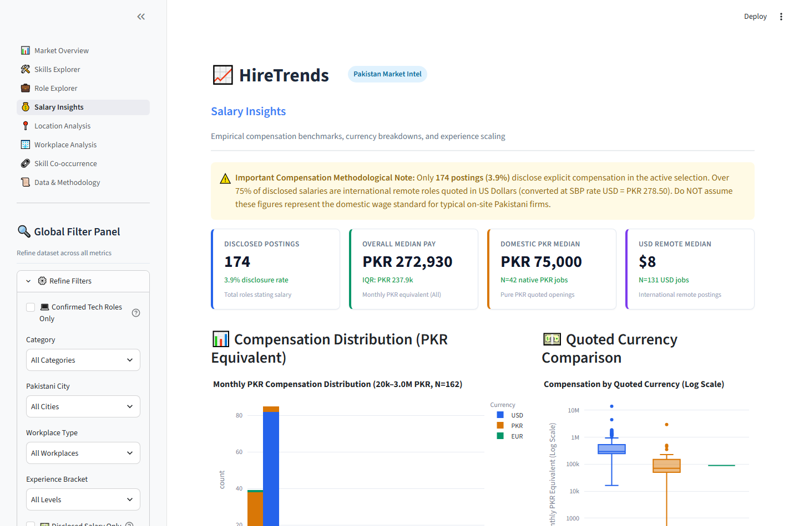
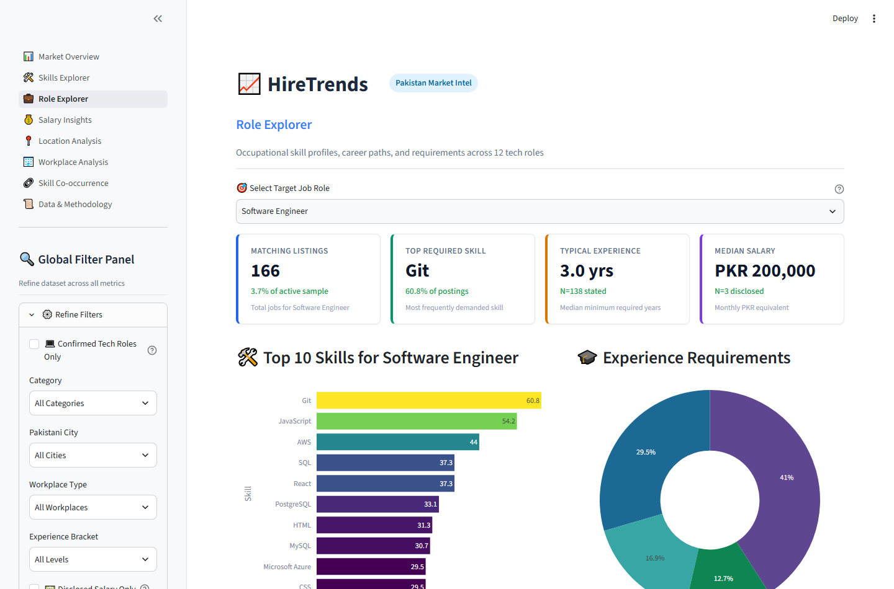

# HireTrends — Pakistan Tech Job Market Intelligence

An ethical, data-driven intelligence platform tracking technology job vacancies, compensation benchmarks, and skill demands across Pakistan's evolving software landscape.

[]()
[](https://www.python.org/downloads/)
[](https://share.streamlit.io/)
[](LICENSE)
[]()

---

## 1. Project Overview & Introduction

**HireTrends** is an applied data engineering and market intelligence project developed during the **LogicBlaze Technologies 8-Week Internship Learning Path**. It collects, cleans, standardizes, models, and visualizes tech recruitment listings in Pakistan. By transforming noisy, unstructured job descriptions into structured tabular schemas and interactive analytics, HireTrends empowers students, software engineers, and hiring managers with empirical market data.

> [!NOTE]
> **Week 3 Master Project Audit & QA Complete:** All Day 1–5 implementations have undergone an exhaustive quality assurance audit. The primary dataset contains **4,491 live Pakistan job records** collected via the official **Headcount Labs Jobs API** (ODbL 1.0). The codebase features an extensible longitudinal trend engine (`src/analysis/trend_analysis.py`), a comprehensive 8-page interactive Streamlit dashboard (`dashboard/app.py`), CSV export capabilities, Playwright-automated visual regression tests, and a **125-test offline unit test suite with 100% pass rate**.

---

## 2. Interactive Dashboard Preview

The complete 8-page Streamlit dashboard runs locally or deployed on Streamlit Community Cloud:

| 📊 Market Overview | 🛠️ Skills Explorer |
| :---: | :---: |
|  |  |
| **💰 Salary Insights** | **📍 Location Analysis** |
|  |  |
| **🔗 Skill Co-occurrence Heatmap** | **💼 Role Explorer** |
|  |  |

*(Full gallery of all 8 pages captured via Playwright Chromium available in [`docs/screenshots/`](docs/screenshots/))*

---

## 3. Key Market Findings & Intelligence Summary

Empirical analysis of 4,491 postings reveals defining characteristics of Pakistan's 2025/2026 tech employment landscape (detailed in [`reports/PAKISTAN_TECH_JOB_MARKET_INSIGHTS.md`](reports/PAKISTAN_TECH_JOB_MARKET_INSIGHTS.md)):

1. **Top In-Demand Technical Skills:**
   - **Python leads overall:** Demanded in **33.3%** of all confirmed tech roles (358 unique jobs), driven by backend web services and AI workloads.
   - **SQL ranks #2:** Essential across 29.9% of tech jobs for relational data modeling.
   - **Modern Web Stack:** JavaScript (27.4%), React (20.8%), TypeScript (12.9%), and Node.js (13.8%).
   - **Cloud & Infrastructure:** AWS (17.4%) and Docker (14.5%) are baseline requirements.
2. **The "Big Three" Metropolises Command 93.3% of Tech Demand:**
   - **Lahore (38.3% / 1,027 jobs):** Software export houses, agencies, and full-stack/mobile web.
   - **Karachi (32.3% / 868 jobs):** FinTech, corporate enterprise, banking, and data systems.
   - **Islamabad (22.7% / 609 jobs):** AI/ML consultancies, cloud architecture, and multinational R&D.
3. **The USD-PKR Remote Divide:**
   - **Domestic PKR Postings ($N=42$):** Median wage of **PKR 75,000 / month** (IQR: 50k–150k PKR).
   - **Overseas USD Remote Contracts ($N=131$):** Median wage of **PKR 278,500 / month** (~$1,000 USD/mo).
   - Remote developers capture an immediate **3.7x salary multiplier** compared to local peers.
4. **Remote Work Dominance:**
   - **51.8%** of postings with explicit workplace policies are **fully remote**, driven by overseas contractors.

---

## 4. Reconciled Census & Statistical Integrity

Every statistic is mathematically balanced across the 4,491 primary records (see [`reports/STATISTICAL_VALIDATION_REPORT.md`](reports/STATISTICAL_VALIDATION_REPORT.md)):

$$\begin{aligned}
\text{Total Dataset } (N=4,491) &= \text{Confirmed Tech } (1,075) + \text{Non-Tech } (2,342) + \text{Manual Review } (1,074) \\
\text{Domestic Mapped } (N=2,684) &= \text{Lahore } (1,027) + \text{Karachi } (868) + \text{Islamabad } (609) + \text{Other Towns } (180) \\
\text{Workplace Known } (N=2,309) &= \text{Remote } (1,197) + \text{On-site } (943) + \text{Hybrid } (169) \quad [2,182 \text{ unstated}]
\end{aligned}$$

---

## 5. Technology Stack

* **Language:** Python 3.12+ (verified: Python 3.12.10)
* **Data Processing & Analytics:** `pandas`, `numpy`
* **Visualization & Reporting:** `plotly`, `matplotlib`, `seaborn`
* **Interactive UI:** `streamlit` (multipage navigation via `st.Page` / `st.navigation`)
* **Automated Visual Testing:** `playwright` (Chromium headless engine)
* **API Ingestion & Resilience:** `requests`, `tenacity`, `python-dotenv`
* **Testing & Quality Assurance:** `pytest` (125 tests, 100% offline)
* **CI/CD & Version Control:** GitHub Actions, Git

---

## 6. Repository Structure

```text
hiretrends-pakistan-job-market/
│
├── data/
│   ├── raw/                  # Raw ingestion records (excluded from Git; watermark locked)
│   ├── processed/            # Cleaned, standardized tabular dataset (jobs_cleaned.csv, 2.2MB)
│   └── samples/              # Anonymized sample records for unit testing
│
├── dashboard/                # Interactive Streamlit multi-page analytics platform
│   ├── app.py                # Main application entry point (st.navigation)
│   ├── data_loader.py        # Cached data ingestion and multi-criteria filters
│   ├── components.py         # Standardized KPI cards, sidebar filters, layout & footers
│   └── pages/                # Modern multipage architecture
│       ├── overview.py       # Market overview & executive KPIs
│       ├── skills_explorer.py # Deep-dive into 69 technical skills with CSV export
│       ├── role_explorer.py  # 12-target occupation skill profiles with CSV export
│       ├── salary_insights.py # Disclosed salary benchmarking (PKR & USD) with CSV export
│       ├── location_analysis.py # Geographic hub analysis & foreign partition
│       ├── workplace_analysis.py # Remote vs on-site vs hybrid trends with known denominators
│       ├── skill_cooccurrence.py # Pairwise co-occurrence heatmap & companion stack explorer
│       └── methodology.py    # Dataset provenance, census reconciliation & SBP rates
│
├── .streamlit/
│   └── config.toml           # Streamlit professional light SaaS theme & server config
│
├── docs/                     # Project documentation, guides, and screenshot assets
│   ├── DEPLOYMENT_GUIDE.md   # Step-by-step Streamlit Community Cloud deployment instructions
│   ├── DEMO_VIDEO_SCRIPT.md  # 2-3 minute presentation walkthrough script
│   └── screenshots/          # Real 1440x950 Playwright PNG screenshots (8 files)
│
├── reports/                  # Technical audit, empirical validation & intelligence reports
│   ├── FINAL_PROJECT_AUDIT.md # Requirement-by-requirement verification table
│   ├── STATISTICAL_VALIDATION_REPORT.md # Formulas, denominators & census reconciliation
│   ├── PAKISTAN_TECH_JOB_MARKET_INSIGHTS.md # Comprehensive 2025/26 market intelligence
│   ├── data_cleaning_report.md # Cleaning, normalization & skills extraction report
│   ├── market_analysis_report.md # EDA & market intelligence findings
│   └── figures/              # Rendered Plotly HTML and PNG charts (14 publication figures)
│
├── src/                      # Production Python modules
│   ├── collection/           # Ingestion, source compliance, Headcount Labs API
│   ├── cleaning/             # Data cleaning, normalization, and NLP skill extraction
│   └── analysis/             # Statistical modeling, location, salary & trend engines
│       └── trend_analysis.py # Extensible longitudinal multi-snapshot growth engine
│
├── tests/                    # Automated unit test suite (125 tests passing offline)
├── .github/workflows/        # GitHub Actions continuous integration workflow
├── requirements.txt          # Production dependencies
├── .env.example              # Environment variable template
└── README.md                 # Project documentation
```

---

## 7. Quickstart & Installation (Windows PowerShell)

### Prerequisites
* Windows 10/11 with PowerShell (or Linux/macOS bash)
* Python 3.12 (verified: Python 3.12.10)
* Git

### Step-by-Step Setup

1. **Clone the Repository:**
   ```powershell
   git clone https://github.com/Awaisbacha55/hiretrends-pakistan-job-market.git
   cd hiretrends-pakistan-job-market
   ```

2. **Create Python Virtual Environment:**
   ```powershell
   py -3.12 -m venv venv
   .\venv\Scripts\Activate.ps1
   ```

3. **Install Dependencies:**
   ```powershell
   python -m pip install --upgrade pip
   pip install -r requirements.txt
   ```

4. **Launch the Dashboard:**
   ```powershell
   streamlit run dashboard/app.py
   ```
   The dashboard opens immediately at `http://localhost:8501`. Because the pre-processed dataset is committed in `data/processed/jobs_cleaned.csv`, **no scraping, external databases, or API keys are required to run the dashboard!**

---

## 8. Streamlit Community Cloud Deployment

HireTrends is ready for zero-configuration public hosting on [Streamlit Community Cloud](https://share.streamlit.io/).

Detailed instructions are available in [`docs/DEPLOYMENT_GUIDE.md`](docs/DEPLOYMENT_GUIDE.md):
1. Sign in to [share.streamlit.io](https://share.streamlit.io/) with GitHub.
2. Select repository `Awaisbacha55/hiretrends-pakistan-job-market` (branch: `main`).
3. Set **Main file path** to `dashboard/app.py`.
4. Click **Deploy!** (takes ~1–2 minutes).

---

## 9. Running Automated Tests

HireTrends includes a comprehensive test suite covering source checking, API mapping, data cleaning, statistical modeling, trend analysis, and dashboard UI logic. All tests run **100% offline**:

```powershell
pytest -v
```

Verification output:
```text
tests/test_analysis_pipeline.py .............                           [ 10%]
tests/test_bulk_collection.py .....................                     [ 27%]
tests/test_cleaning_pipeline.py ...................................     [ 55%]
tests/test_dashboard.py ..............                                  [ 66%]
tests/test_headcount_api.py ..........                                  [ 74%]
tests/test_headcount_sample.py ........                                 [ 80%]
tests/test_scraper.py ...........                                       [ 89%]
tests/test_source_checker.py .............                              [100%]
============================= 125 passed in 4.93s =============================
```

---

## 10. Data Ethics & Responsible Use Charter

- **Terms of Service Supremacy:** Automated collection respects platform terms. Prohibited sources (e.g. Mustakbil) are blocked fail-closed; commercial job boards (e.g. Rozee.pk) requiring permission are never harvested without authorization.
- **Official API Ingestion:** Live data is sourced under official Open Database License (ODbL 1.0) and Database Contents License (DbCL 1.0) courtesy of [Headcount Labs](https://headcountlabs.com).
- **Privacy & Copyright Protection:** Candidate PII is never harvested. Full-text employer job descriptions are strictly excluded from git version control to protect employer copyright.
- **Exchange Rate Normalization:** Foreign salaries are standardized to monthly PKR using official State Bank of Pakistan reference rates (USD = 278.50 PKR, EUR = 295.00 PKR).

---

## 11. License & Attribution

- **Source Code:** Distributed under the open-source [MIT License](LICENSE).
- **Primary Dataset:** Courtesy of [Headcount Labs](https://headcountlabs.com) under ODbL 1.0 & DbCL 1.0.
- **Geographic Data:** Location entities © OpenStreetMap contributors and Overture Maps.
