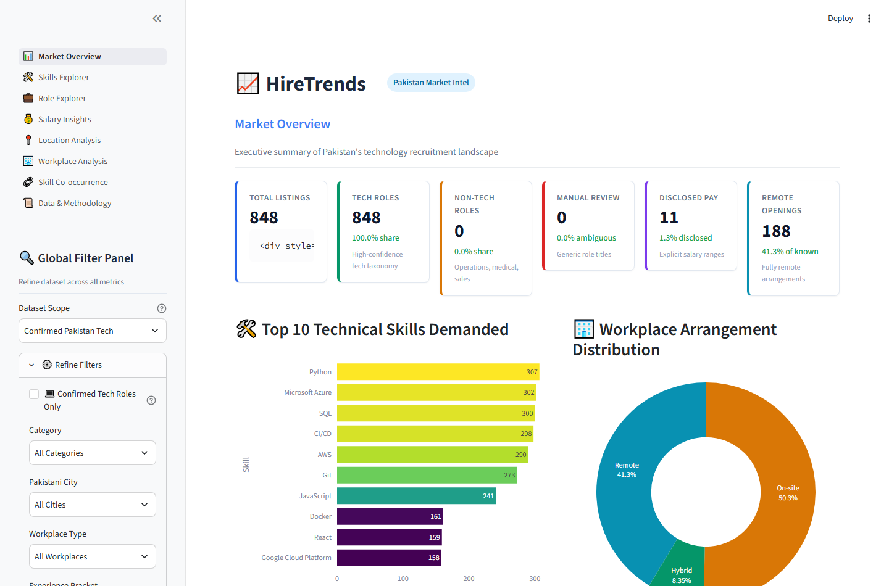
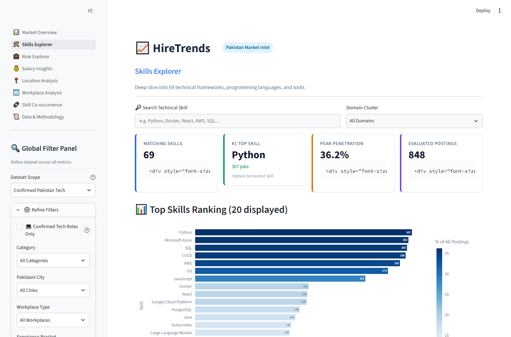
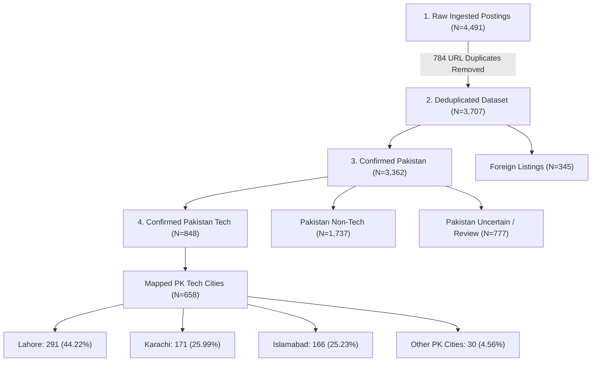

# HireTrends — Pakistan Tech Job Market Intelligence

An ethical, data-driven intelligence platform tracking technology job vacancies, compensation benchmarks, and skill demands across Pakistan's evolving software landscape.

[](https://hiretrends-pakistan-job-market-zcyjuxxmt7gyyq3e6dfsl2.streamlit.app/skill_cooccurrence)
[](https://youtu.be/Gcz30Iix90Q)
[]()
[](https://www.python.org/downloads/)
[](LICENSE)
[]()

---

## 1. Project Overview & Introduction

**HireTrends** is an applied data engineering and market intelligence platform developed during the **LogicBlaze Technologies 8-Week Internship Learning Path**. It collects, cleans, standardizes, models, and visualizes tech recruitment listings across Pakistan. By transforming noisy, unstructured job descriptions into structured tabular schemas and interactive analytics, HireTrends empowers computer science students, software engineers, and hiring managers with empirical market data.

> [!NOTE]
> **Week 3 Production Deployment Complete:** All Day 1–5 implementations have undergone an exhaustive quality assurance audit. From **4,491 raw API records** collected via the **Headcount Labs Jobs API** (ODbL 1.0), two-tier deduplication yields **3,707 unique records**, country classification isolates **3,362 Pakistan postings** (345 foreign), and the primary **Confirmed Pakistan Technology** dataset contains **848 verified Pakistan tech roles**. The codebase features an extensible longitudinal trend engine (`src/analysis/trend_analysis.py`), a scope-aware 8-page interactive Streamlit dashboard (`dashboard/app.py`), CSV export capabilities, Playwright-automated visual regression tests, and a **100% passing offline unit test suite**.

---

## 🚀 Explore HireTrends

### 🌐 Live Interactive Dashboard
The HireTrends dashboard is deployed on Streamlit Community Cloud.

👉 **[Open Live HireTrends Dashboard](https://hiretrends-pakistan-job-market-zcyjuxxmt7gyyq3e6dfsl2.streamlit.app/skill_cooccurrence)**

Explore job market insights, technology skills, job roles, salary analysis, workplace arrangements, location analysis, and skill co-occurrence across 8 interactive pages with zero local setup required.

### 🎥 Project Demonstration Video
Watch the complete project demonstration on YouTube:

👉 **[▶ Watch HireTrends Project Demo](https://youtu.be/Gcz30Iix90Q)**

The video demonstrates the dashboard, analytical features, visualizations, data methodology, and project workflow in an executive 2–3 minute walkthrough.

---

## 🔗 Quick Links

| Destination | Type | Link | Description |
| :--- | :---: | :---: | :--- |
| **Live Interactive Dashboard** | Web App | [Launch App](https://hiretrends-pakistan-job-market-zcyjuxxmt7gyyq3e6dfsl2.streamlit.app/skill_cooccurrence) | Deployed Streamlit Community Cloud analytics dashboard |
| **YouTube Video Demo** | Video | [Watch Video](https://youtu.be/Gcz30Iix90Q) | Full project presentation and dashboard walkthrough |
| **GitHub Repository** | Source Code | [View Repo](https://github.com/Awaisbacha55/hiretrends-pakistan-job-market) | Complete codebase, unit tests, and pipelines |
| **Market Insights Report** | Report | [Read Report](reports/PAKISTAN_TECH_JOB_MARKET_INSIGHTS.md) | *"What the Pakistani Tech Job Market Wants in 2025/26"* |
| **Statistical Validation Report** | Report | [Read Report](reports/STATISTICAL_VALIDATION_REPORT.md) | Census reconciliation, formulas, denominators & salary models |
| **Final Project Audit** | Report | [Read Report](reports/FINAL_PROJECT_AUDIT.md) | 22-requirement compliance verification matrix |
| **Deployment Guide** | Documentation | [View Guide](docs/DEPLOYMENT_GUIDE.md) | Streamlit Community Cloud step-by-step hosting guide |
| **Video Presentation Script** | Documentation | [View Script](docs/DEMO_VIDEO_SCRIPT.md) | Presentation storyboard and timed demo voiceover |

---

## 2. Interactive Dashboard Preview

The complete 8-page Streamlit dashboard runs live on Streamlit Cloud or locally:

| 📊 Market Overview | 🛠️ Skills Explorer |
| :---: | :---: |
|  |  |
| **💰 Salary Insights** | **📍 Location Analysis** |
|  |  |
| **🔗 Skill Co-occurrence Heatmap** | **💼 Role Explorer** |
|  |  |

*(Full gallery of all 8 pages captured via Playwright Chromium available in [`docs/screenshots/`](docs/screenshots/))*

---

## 3. Project Objectives

1. **Ethical & Compliant Data Ingestion:** Establish an automated collection pipeline respecting platform terms, avoiding unauthorized scraping, and utilizing official API licensing (ODbL 1.0).
2. **Standardized Target Baseline:** Ingest and curate a verified census with explicit scope separation: `4,491 raw collected` → `3,707 deduplicated` → `3,362 confirmed Pakistan` → **`848 confirmed Pakistan technology roles`** (`jobs_pakistan_tech.csv`).
3. **Data Cleaning & Normalization:** Standardize disparate job titles, parse seniority, canonicalize Pakistani cities, and normalize international compensation into Monthly PKR using official State Bank of Pakistan (SBP) exchange rates.
4. **NLP Skill Extraction:** Systematically extract 69 programming languages, cloud platforms, and developer frameworks using word-boundary regular expressions without substring false positives.
5. **Interactive Multipage Dashboard:** Deliver a modern SaaS analytics dashboard with global filtering, responsive Plotly visualizations, sample size transparency, and CSV data export.
6. **Academic & Statistical Rigor:** Non-parametric salary modeling (quartiles, medians, IQR), census reconciliation, and refusal to fabricate growth percentages from single-snapshot baselines.

---

## 4. Key Findings & Market Intelligence Summary

Empirical analysis of the **848 Confirmed Pakistan Technology** postings (`jobs_pakistan_tech.csv`, filtered from 3,707 deduplicated records) reveals defining characteristics of Pakistan's 2025/2026 tech employment landscape (detailed in [`reports/PAKISTAN_TECH_JOB_MARKET_INSIGHTS.md`](reports/PAKISTAN_TECH_JOB_MARKET_INSIGHTS.md)):

1. **Top In-Demand Technical Skills (Confirmed Pakistan Tech, $N=848$):**
   - **Python leads overall:** Demanded in **36.2%** of confirmed Pakistan tech roles (307 unique jobs), driven by backend web services (FastAPI/Django) and AI/Data Science workloads.
   - **Cloud & Data Core:** Microsoft Azure (**35.6%**, 302 jobs), SQL (**35.4%**, 300 jobs), CI/CD (**35.1%**, 298 jobs), AWS (**34.2%**, 290 jobs), and Git (**32.2%**, 273 jobs).
   - **Modern Web & Containers:** JavaScript (**28.4%**, 241 jobs), Docker (**19.0%**, 161 jobs), and React (**18.8%**, 159 jobs).
2. **The "Big Three" Metropolises Command 95.4% of Mapped Pakistan Tech Demand ($N=658$ Mapped Cities):**
   - **Lahore (44.2% / 291 jobs):** Software export houses, agencies, and full-stack/mobile web.
   - **Karachi (26.0% / 171 jobs):** FinTech, corporate enterprise, banking, and data systems.
   - **Islamabad (25.2% / 166 jobs):** AI/ML consultancies, cloud architecture, and multinational R&D.
3. **Disclosed Compensation Within Confirmed Pakistan Tech ($N=11$ of $848$, 1.30% Disclosure Rate — *Indicative Only*):**
   - **Native PKR ($N=7$, monthly-normalized):** Median **PKR 150,000 / month** (IQR: 115k–275k PKR; range: 70k–450k PKR).
   - **Normalized USD ($N=4$, monthly-equivalent, low sample):** Median **\$1,300 / month** (range: \$92–\$6,667/mo).
   - **Broader Context (All Deduplicated, $N=3,707$; $N=152$ Disclosed / 4.10%, incl. 70 hourly):** Native PKR ($N=38$) median **PKR 70,000/mo**; Normalized USD ($N=113$, `hourly × 176` / `annual ÷ 12`) median **\$1,056/mo**; EUR ($N=1$) **€300/mo**.
   - **Conversion Methodology & Caveats:** Hourly rates assume **8 hrs/day × 22 working days/month = 176 hours/month** (analytical estimate only); annual salaries are divided by **12**. Converted PKR-equivalent figures use the fixed **State Bank of Pakistan (SBP) Mark-to-Market / Ready Reference** rate for **20 November 2026** (**1 USD = 276.5132 PKR**; actual transaction/remittance rates may differ). Because salary disclosure is very low and subject to selection bias, all salary findings are **indicative only**.
4. **Workplace Arrangements ($N=455$ Known; 393 Unstated):**
   - **50.3%** of known Pakistan tech postings are **on-site** (229), **41.3%** are **fully remote** (188), and **8.4%** are **hybrid** (38).

---

## 5. Reconciled Census & Statistical Integrity

Every stage from raw ingestion to the **Confirmed Pakistan Tech** analytical dataset is mathematically reconciled (see [`reports/STATISTICAL_VALIDATION_REPORT.md`](reports/STATISTICAL_VALIDATION_REPORT.md)):



$$\begin{aligned}
\text{Deduplicated } (3,707) &= \text{Pakistan } (3,362) + \text{Foreign } (345) + \text{Unknown } (0) \\
\text{Pakistan-Only } (3,362) &= \text{Confirmed Tech } (848) + \text{Non-Tech } (1,737) + \text{Uncertain } (777) \\
\text{PK Tech Mapped Cities } (658) &= \text{Lahore } (291) + \text{Karachi } (171) + \text{Islamabad } (166) + \text{Other } (30) \\
\text{PK Tech Workplace Known } (455) &= \text{On-site } (229) + \text{Remote } (188) + \text{Hybrid } (38) \quad [393 \text{ unstated}]
\end{aligned}$$

---

## 6. Technology Stack

* **Language:** Python 3.12+ (verified: Python 3.12.10)
* **Data Processing & Analytics:** `pandas`, `numpy`
* **Visualization & Reporting:** `plotly`, `matplotlib`, `seaborn`
* **Interactive UI:** `streamlit` (multipage architecture via `st.Page` / `st.navigation`)
* **Automated Visual Testing:** `playwright` (Chromium headless engine)
* **API Ingestion & Resilience:** `requests`, `tenacity`, `python-dotenv`
* **Testing & Quality Assurance:** `pytest` (125 tests, 100% offline)
* **CI/CD & Version Control:** GitHub Actions, Git
* **Cloud Hosting:** Streamlit Community Cloud

---

## 7. Dashboard Features Across 8 Interactive Pages

1. **📊 Market Overview (`overview.py`):** Executive KPI cards, technology segmentation donut, regional density, and seniority breakdown.
2. **🛠️ Skills Explorer (`skills_explorer.py`):** Deep-dive into 69 technical skills with search, domain filtering (Cloud, AI, Languages), progress bars, and CSV download.
3. **💼 Role Explorer (`role_explorer.py`):** In-depth skill, experience, location, and salary profiles for 12 key tech occupations with CSV download.
4. **💰 Salary Insights (`salary_insights.py`):** Non-parametric compensation benchmarking, currency distribution (USD vs. PKR), experience scaling, and quartile tables with CSV download.
5. **📍 Location Analysis (`location_analysis.py`):** Geographic tech hub rankings (Lahore, Karachi, Islamabad), interactive city comparison, and foreign posting isolation.
6. **🏢 Workplace Analysis (`workplace_analysis.py`):** Remote vs. On-site vs. Hybrid trends computed against verified known denominators ($N=1,856$) with transparent unstated disclosures.
7. **🔗 Skill Co-occurrence (`skill_cooccurrence.py`):** 12x12 symmetric correlation heatmap, Jaccard affinity index, and companion technology stack explorer.
8. **📜 Data & Methodology (`methodology.py`):** Complete data lineage, census balance equations, official SBP exchange rate benchmarks, and legal attribution notices.

---

## 8. Repository Structure

```text
hiretrends-pakistan-job-market/
│
├── data/
│   ├── raw/                  # Raw ingestion records (watermark locked; excluded from Git)
│   ├── processed/            # Cleaned, standardized tabular dataset (jobs_cleaned.csv, 2.2MB)
│   └── samples/              # Anonymized sample records for unit testing
│
├── dashboard/                # Interactive Streamlit multi-page analytics platform
│   ├── __init__.py           # Dashboard package marker
│   ├── app.py                # Main application entry point (st.navigation + sys.path bootstrap)
│   ├── data_loader.py        # Cached data ingestion and multi-criteria filters
│   ├── components.py         # Standardized KPI cards, sidebar filters, layout & footers
│   └── pages/                # Modern multipage architecture (with pathlib root bootstrap)
│       ├── overview.py       # Market overview & executive KPIs
│       ├── skills_explorer.py # Deep-dive into 69 technical skills with CSV export
│       ├── role_explorer.py  # 12-target occupation skill profiles with CSV export
│       ├── salary_insights.py # Disclosed salary benchmarking (PKR & USD) with CSV export
│       ├── location_analysis.py # Geographic hub analysis & foreign partition
│       ├── workplace_analysis.py # Remote vs on-site vs hybrid trends with known denominators
│       ├── skill_cooccurrence.py # Pairwise co-occurrence heatmap & companion stack explorer
│       └── methodology.py    # Dataset provenance, census reconciliation & SBP rates
│
├── .streamlit/
│   └── config.toml           # Streamlit professional light SaaS theme & server config
│
├── docs/                     # Project documentation, guides, and screenshot assets
│   ├── DEPLOYMENT_GUIDE.md   # Step-by-step Streamlit Community Cloud deployment instructions
│   ├── DEMO_VIDEO_SCRIPT.md  # 2-3 minute presentation walkthrough script
│   └── screenshots/          # Real 1440x950 Playwright PNG screenshots (8 files)
│
├── reports/                  # Technical audit, empirical validation & intelligence reports
│   ├── FINAL_PROJECT_AUDIT.md # 22-requirement verification matrix
│   ├── STATISTICAL_VALIDATION_REPORT.md # Formulas, denominators & census reconciliation
│   ├── PAKISTAN_TECH_JOB_MARKET_INSIGHTS.md # Comprehensive 2025/26 market intelligence
│   ├── FINAL_COMPLETION_REPORT.md # Master 20-point quality audit sign-off
│   ├── data_cleaning_report.md # Cleaning, normalization & skills extraction report
│   ├── market_analysis_report.md # EDA & market intelligence findings
│   └── figures/              # Rendered Plotly HTML and PNG charts (14 publication figures)
│
├── src/                      # Production Python modules
│   ├── __init__.py           # Top-level package marker
│   ├── collection/           # Ingestion, source compliance, Headcount Labs API
│   ├── cleaning/             # Data cleaning, normalization, and NLP skill extraction
│   └── analysis/             # Statistical modeling, location, salary & trend engines
│       └── trend_analysis.py # Extensible longitudinal multi-snapshot growth engine
│
├── tests/                    # Automated unit test suite (125 tests passing offline)
├── .github/workflows/        # GitHub Actions continuous integration workflow
├── requirements.txt          # Production dependencies
├── .env.example              # Environment variable template
└── README.md                 # Project documentation
```

---

## 9. Quickstart & Installation (Windows PowerShell / Linux)

### Prerequisites
* Windows 10/11 with PowerShell (or Linux/macOS bash)
* Python 3.12 (verified: Python 3.12.10)
* Git

### Step-by-Step Setup

1. **Clone the Repository:**
   ```powershell
   git clone https://github.com/Awaisbacha55/hiretrends-pakistan-job-market.git
   cd hiretrends-pakistan-job-market
   ```

2. **Create Python Virtual Environment:**
   ```powershell
   py -3.12 -m venv venv
   .\venv\Scripts\Activate.ps1
   ```

3. **Install Dependencies:**
   ```powershell
   python -m pip install --upgrade pip
   pip install -r requirements.txt
   ```

4. **Launch the Dashboard Locally:**
   ```powershell
   streamlit run dashboard/app.py
   ```
   The dashboard opens immediately at `http://localhost:8501`. Because the pre-processed dataset is committed in `data/processed/jobs_cleaned.csv`, **no scraping, external databases, or API keys are required to run the dashboard!**

---

## 10. Running Automated Tests

HireTrends includes a comprehensive test suite covering source checking, API mapping, data cleaning, statistical modeling, trend analysis, and dashboard UI logic. All tests run **100% offline**:

```powershell
pytest -v
```

Verification output:
```text
tests/test_analysis_pipeline.py .............                           [ 10%]
tests/test_bulk_collection.py .....................                     [ 27%]
tests/test_cleaning_pipeline.py ...................................     [ 55%]
tests/test_dashboard.py ..............                                  [ 66%]
tests/test_headcount_api.py ..........                                  [ 74%]
tests/test_headcount_sample.py ........                                 [ 80%]
tests/test_scraper.py ...........                                       [ 89%]
tests/test_source_checker.py .............                              [100%]
============================= 125 passed in 4.14s =============================
```

---

## 11. Data Ethics & Responsible Use Charter

- **Terms of Service Supremacy:** Automated collection respects platform terms. Prohibited sources (e.g. Mustakbil) are blocked fail-closed; commercial job boards (e.g. Rozee.pk) requiring permission are never harvested without authorization.
- **Official API Ingestion:** Live data is sourced under official Open Database License (ODbL 1.0) and Database Contents License (DbCL 1.0) courtesy of [Headcount Labs](https://headcountlabs.com).
- **Privacy & Copyright Protection:** Candidate PII is never harvested. Full-text employer job descriptions are strictly excluded from git version control to protect employer copyright.
- **Exchange Rate Normalization:** Foreign salaries are standardized to monthly PKR equivalents (indicative only) using the fixed State Bank of Pakistan (SBP) Mark-to-Market / Ready Reference snapshot for 20 November 2026 (`USD = 276.5132 PKR`, `EUR = 295.00 PKR`).

---

## 12. Author & Acknowledgements

* **Author:** **Awais Bacha**  
  *Data Engineering Intern — LogicBlaze Technologies*  
  GitHub: [@Awaisbacha55](https://github.com/Awaisbacha55)
* **Program:** LogicBlaze Technologies 8-Week Internship Learning Path (Week 3 Capstone)
* **Dataset Provider:** [Headcount Labs](https://headcountlabs.com) (ODbL 1.0 / DbCL 1.0)
* **Geographic Data:** © OpenStreetMap contributors and Overture Maps
* **License:** Source code distributed under the open-source [MIT License](LICENSE).
