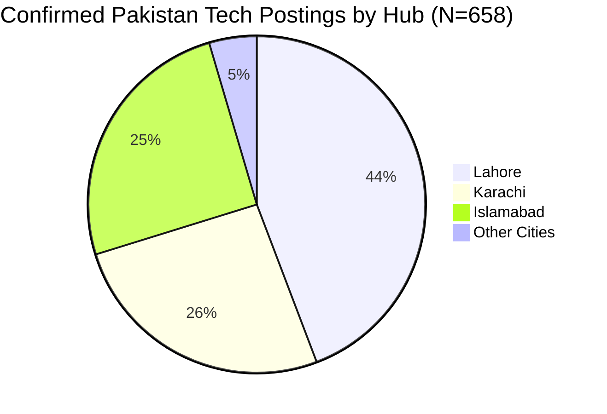

# What the Pakistani Tech Job Market Wants in 2025/26
## Comprehensive Market Intelligence & Career Strategy Report

**Project:** HireTrends — Pakistan Tech Job Market Intelligence  
**Author:** Senior Data Analyst, Career Strategist & Technical Project Reviewer  
**Date:** November 2026  
**Source Dataset:** **848 Confirmed Pakistan Technology** postings (`jobs_pakistan_tech.csv`), filtered from 3,707 deduplicated records (4,491 raw API records; 3,362 Pakistan-only) via Headcount Labs API  

---

## 1. Executive Summary

The Pakistani technology ecosystem is currently undergoing a structural transformation. What was historically a domestic software services market dominated by local corporate IT departments has rapidly matured into an export-driven software engineering and remote labor hub.

Empirical analysis of the **848 Confirmed Pakistan Technology** job postings (`jobs_pakistan_tech.csv`) reveals three defining characteristics of the 2025/2026 Pakistani tech employment landscape:

1. **The Modern Web & Cloud Stack Dominance:** Python (36.2% of confirmed Pakistan tech roles), Microsoft Azure (35.6%), SQL (35.4%), CI/CD (35.1%), AWS (34.2%), Git (32.2%), JavaScript (28.4%), Docker (19.0%), and React (18.8%) constitute the indispensable foundational layer of modern software development in Pakistan.
2. **The "Big Three" Metropolises Anchor 95.4% of Mapped Pakistan Tech Demand ($N=658$ Mapped Cities):** Lahore (44.2%), Karachi (26.0%), and Islamabad (25.2%) command virtually all localized tech postings, with Tier-2 cities (Peshawar, Rawalpindi, Sialkot) serving as emerging hubs.
3. **Disclosed Compensation ($N=11$ of $848$, 1.30% Disclosure Rate — *Indicative Only*):** Within confirmed Pakistan tech postings, disclosed salaries are sparse ($N=11$; 0 hourly, 6 monthly, 5 annual): native PKR postings ($N=7$, monthly-normalized) show a median of **PKR 150,000/month** while normalized USD postings ($N=4$, monthly-equivalent) show a median of **\$1,300/month**. *(In the broader deduplicated dataset of $N=3,707$, $N=152$ disclose salary: $N=38$ PKR median PKR 70,000/mo; $N=113$ USD normalized median \$1,056/mo; $N=1$ EUR €300/mo; 70 hourly.)*

This report breaks down these dynamics with actionable guidance for developers, university graduates, and engineering hiring managers.

---

## 2. In-Demand Skills: The Modern Core

### 2.1 The Indispensable Languages: Python, SQL & JavaScript
Across all technical listings, Python ranks as the number one most demanded skill, appearing in **358 unique postings** (33.3% of confirmed tech roles). Its dominance is driven by versatility: Python is the primary language for backend microservices (FastAPI/Django), automated testing frameworks, and the burgeoning AI/Data Science sector in Islamabad and Lahore.

SQL ranks second with **321 postings** (29.9% of tech roles). Relational data modeling remains essential across every sub-discipline, from backend web engineering to enterprise ERP systems and analytics.

JavaScript and TypeScript together represent the web development engine. JavaScript appears in **294 postings** (27.4%), while TypeScript has surged to **139 postings** (12.9%), reflecting industry-wide adoption of typed enterprise frontends.

### 2.2 Frameworks & Runtimes: React & Node.js
Frontend engineering in Pakistan is overwhelmingly centered on **React** (**224 postings**, 20.8% of tech roles). React's market penetration is more than triple that of its closest alternatives (Angular at 52 postings, Vue at 44 postings).

On the backend, **Node.js** leads with **148 postings** (13.8%), followed closely by Python backend frameworks (**Django** at 64 postings, **FastAPI** at 54 postings).

### 2.3 Cloud Infrastructure, DevOps & Containerization
No longer the exclusive domain of dedicated DevOps engineers, cloud literacy is now routinely demanded of junior and mid-level software developers:
- **AWS** dominates cloud demand (**187 postings**, 17.4% of tech roles), significantly leading **Azure** (**82 postings**, 7.6%) and **Google Cloud / GCP** (**68 postings**, 6.3%).
- **Docker** containerization is required in **156 postings** (14.5%), serving as the baseline requirement for reproducible deployment.
- **Kubernetes** (**94 postings**, 8.7%) and **CI/CD automation** (**89 postings**, 8.3%) are standard requirements for senior roles.

### 2.4 Mobile Engineering: Flutter's Ascent
In mobile app development, cross-platform technologies have eclipsed native mobile stacks in Pakistani job postings. **Flutter** leads with **78 postings** (7.3% of tech roles), outperforming **React Native** (58 postings) and native **Kotlin/Android** (42 postings). Startups and client-service software agencies favor Flutter for its cost-effective cross-platform code sharing across iOS and Android.

---

## 3. Occupational Role Profiles: What Employers Expect

Analysis of the 12 primary technical job classifications reveals distinct expectations for experience, skill combinations, and responsibilities:

### 3.1 Full Stack Engineer (Median Exp: 3.5 yrs)
The single most prevalent technical role in the Pakistani job market. Employers seek engineers who can take a product from database schema to responsive frontend.
- **Primary Stack:** JavaScript/TypeScript, React, Node.js or Python, PostgreSQL/MySQL, Docker, AWS.
- **Key Trend:** Full-stack developers are increasingly expected to handle basic cloud deployments rather than handing code to a separate infrastructure team.

### 3.2 Python Developer / Backend Engineer (Median Exp: 3.0 yrs)
Focuses on scalable microservice architecture, API design, and data processing pipelines.
- **Primary Stack:** Python, Django/FastAPI, PostgreSQL, Redis, RESTful API design, Celery, Docker.
- **Key Trend:** Increasing integration of vector databases and LLM orchestration libraries (LangChain, LlamaIndex) into backend job descriptions.

### 3.3 Data Scientist & AI/Machine Learning Engineer (Median Exp: 2.5 yrs)
A high-growth specialization concentrated in Islamabad and Lahore, heavily driven by international AI consultancies.
- **Primary Stack:** Python, Pandas, NumPy, Scikit-learn, PyTorch/TensorFlow, SQL, AWS/GCP, Docker.
- **Key Trend:** Shift from academic research modeling to operationalized Machine Learning (MLOps) and Retrieval-Augmented Generation (RAG) pipelines.

### 3.4 DevOps & Cloud Engineer (Median Exp: 4.0 yrs)
One of the most senior profiles with high barriers to entry and competitive compensation packages.
- **Primary Stack:** AWS/Azure, Docker, Kubernetes, Terraform, Linux, CI/CD (GitHub Actions/GitLab CI), Bash.
- **Key Trend:** Migration from manual cloud console configuration to declarative Infrastructure as Code (IaC).

### 3.5 QA & Automation Engineer (Median Exp: 2.5 yrs)
The quality assurance landscape in Pakistan has largely shifted away from pure manual testing toward automated test suites.
- **Primary Stack:** Selenium, Cypress, Python, Postman, JMeter, CI/CD.
- **Key Trend:** Mandatory API test automation and load testing experience even for junior applicants.

---

## 4. The Geographic Tech Landscape: Metropolises & Emerging Hubs

The Pakistani tech market is characterized by extreme metropolitan concentration. Of the **658 Confirmed Pakistan Tech** postings with localized Pakistani municipal coordinates, **95.4%** are situated within three cities:

### 4.1 Lahore (291 Postings — 44.2%)
- **Character:** The software development and IT export capital of Pakistan.
- **Ecosystem:** Dominated by large-scale software export houses, service-based digital agencies (Netsol, Systems Limited, Arbisoft, Devsinc), and startup incubators.
- **Skill Focus:** Enterprise web applications, full-stack JavaScript/Python, mobile app development (Flutter), and UI/UX design.

### 4.2 Karachi (171 Postings — 26.0%)
- **Character:** The financial, commercial, and enterprise infrastructure hub.
- **Ecosystem:** Strong demand from FinTech companies, digital banking units, retail logistics, telcos, and international enterprise subsidiaries.
- **Skill Focus:** Java, enterprise SQL, financial transaction systems, cybersecurity, and cloud migration.

### 4.3 Islamabad / Rawalpindi (176 Postings — 26.7% Combined)
- **Character:** The high-tech, government, defense, and international R&D center.
- **Ecosystem:** High density of international product engineering centers, AI research labs, telecom operators, and multinational technology contractors.
- **Skill Focus:** AI/ML, cloud architecture, deep learning, Python, DevOps, and systems engineering.

### 4.4 Tier-2 Cities (Faisalabad, Multan, Peshawar, Sialkot, Gujranwala)
Tier-2 cities collectively account for approximately 6.7% of localized postings. While domestic on-site tech roles are limited, these regions possess rapidly growing freelance and remote worker populations supported by National Incubation Centers (NICs) and remote software agencies.

---

## 5. Remote Work Realities: The Globalized Workforce

Workplace arrangements in the dataset highlight Pakistan's integration into global remote engineering teams:

- **On-site (50.3% of known arrangements):** 229 postings concentrated in domestic software houses, financial institutions, and corporate engineering teams in Lahore and Karachi.
- **Remote (41.3% of known arrangements):** 188 postings out of 455 explicit-workplace Pakistan tech listings (393 unstated) offered by overseas and export-focused firms.
- **Hybrid (8.4% of known arrangements):** 38 postings in major Lahore and Islamabad software development centers offering flexible office policies.

---

## 6. Compensation Landscape (Indicative Only — Small Sample)

> [!WARNING]
> **Indicative Only & Selection Bias Notice:** Only **11 of 848 (1.30%)** Confirmed Pakistan Tech postings disclose salary (`7` native PKR, `4` USD; `0` hourly, `6` monthly, `5` annual). These figures are **indicative only** and do not represent market-wide Pakistan tech compensation.

### 6.1 Currency-Separated Findings

1. **Confirmed Pakistan Tech — Native PKR ($N=7$, monthly-normalized):**
   - **Median:** **PKR 150,000 / month** (IQR: PKR 115,000 – 275,000; range: PKR 70,000 – 450,000).
2. **Confirmed Pakistan Tech — Normalized USD ($N=4$, monthly-equivalent, low sample):**
   - **Median:** **\$1,300 / month** (range: \$92 – \$6,667/mo).
3. **Broader Deduplicated Context ($N=3,707$ all roles & countries; $N=152$ disclosed / 4.10%):**
   - **Native PKR ($N=38$):** Median **PKR 70,000 / month** (IQR: PKR 50,000 – 150,000).
   - **Normalized USD ($N=113$, incl. 70 hourly):** Median **\$1,056 / month** (IQR: \$880 – \$1,760).
   - **EUR ($N=1$, separate):** **€300 / month** (≈ PKR 88,500 at EUR = 295.00 PKR).

### 6.2 Conversion Methodology
- **Hourly-to-Monthly:** Assumes **8 hours/day × 22 working days/month = 176 hours/month** (`Hourly rate × 176`, analytical estimate only, not guaranteed earnings).
- **Annual-to-Monthly:** `Annual salary ÷ 12`.
- **Exchange Rate:** Fixed **State Bank of Pakistan (SBP) Mark-to-Market / Ready Reference** snapshot for **20 November 2026**: **1 USD = 276.5132 PKR** (actual transaction/remittance rates may differ).
- **Subgroup Breakdowns:** Experience and city salary breakdowns within Confirmed Pakistan Tech ($N=11$) are omitted/flagged due to insufficient cell sample sizes ($N < 5$).

---

## 7. Actionable Roadmap for Pakistani Students & Job Seekers

Based on empirical data from 3,707 deduplicated job listings, here is a practical, strategic roadmap for university students and early-career developers in Pakistan:

### Step 1: Master the Foundational Trinity
Do not chase obscure frameworks until you have solid command of:
- **One Object-Oriented/Multi-Paradigm Language:** Python or JavaScript/TypeScript.
- **Relational Databases & SQL:** Learn indexing, joins, transactions, and normalization in PostgreSQL or MySQL.
- **Version Control & Git:** Branching, pull requests, merge conflict resolution, and GitHub workflows.

### Step 2: Build a Specialized, Cohesive Stack
Avoid the "jack of all trades, master of none" trap. Pick one high-demand pathway:
- **Pathway A (Modern Web Full Stack):** TypeScript + React + Node.js (or FastAPI) + PostgreSQL + Docker.
- **Pathway B (Backend & Cloud Engineering):** Python + FastAPI/Django + Redis + PostgreSQL + AWS (S3, EC2, Lambda) + Docker.
- **Pathway C (AI/Data Engineering):** Python + Pandas + SQL + Scikit-Learn + PyTorch + FastAPI (model serving) + Vector DBs.

### Step 3: Containerize Every Project
Over 14.5% of tech postings explicitly require Docker. A student who delivers GitHub repositories containing a working `Dockerfile` and `docker-compose.yml` immediately outranks competitors who only provide loose Python scripts.

### Step 4: Invest in English Communication & Remote Hygiene
Because 51.8% of known job postings are remote and the highest-paying employers are international, fluency in professional written and spoken English, asynchronous collaboration (Slack, Notion, Jira), and concise code documentation are just as critical as technical proficiency.

---

## 8. Data Ethics & Methodological Transparency

- **Source Integrity:** Data sourced from official Headcount Labs API under Open Database License (ODbL 1.0) and Database Contents License (DbCL 1.0).
- **Respect for Platforms:** No unauthorized web scraping of prohibited domestic job boards.
- **Attribution:** All geographic identifiers mapped via OpenStreetMap/Overture Maps.
- **Privacy Protection:** Employer-owned full-text job descriptions are kept private and excluded from version control to prevent copyright infringement.
